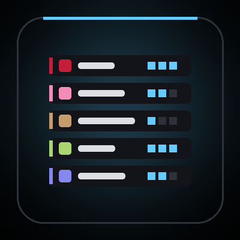
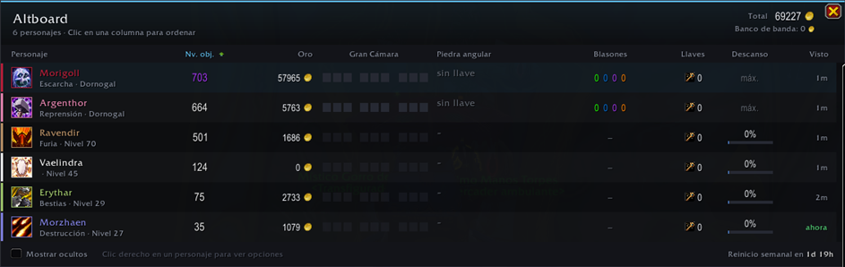
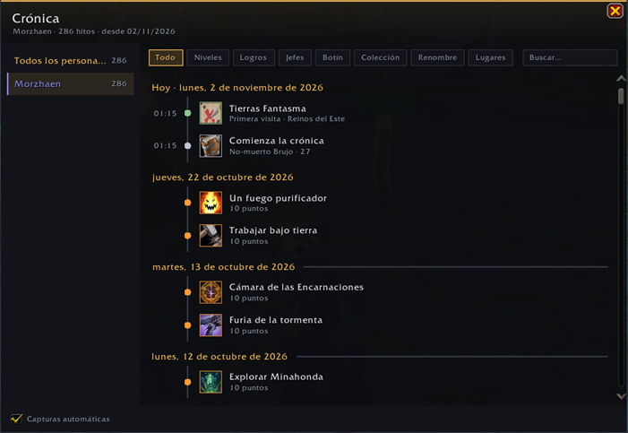
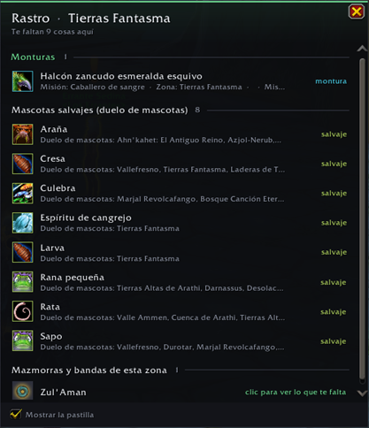
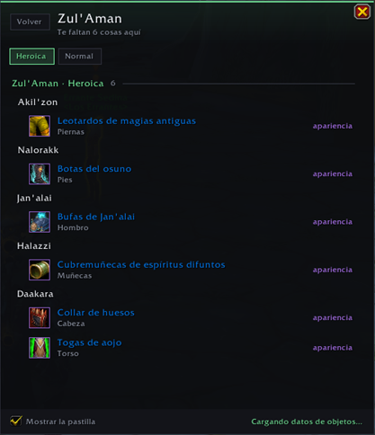

# wow-addons

World of Warcraft addons by **Morigoll**, for retail The War Within 11.2.5, also running on Midnight 12.1 and WoW Forever (interfaces 110205, 110207, 120105, 120107, 16001). No libraries, English and Spanish, one dark visual style.

| | Addon | What it does |
|---|---|---|
|  | **Barracks** | Every alt at a glance: item level, gold, Great Vault, keystone, crests, lockouts, rested XP |
|  | **Keepsake** | A journal of each character's story, with automatic screenshots |
|  | **Treasure Trail** | What you can still collect in this zone, dungeon or raid |

**Install:** download the zip of the addon you want from [Releases](../../releases), and extract it into your game client's `Interface\AddOns` folder (`World of Warcraft\_retail_\Interface\AddOns` for retail).

## Barracks



Every alt at a glance, in one window: `/alts` (or `/barracks`, the minimap button, the minimap addon menu, or a key binding under Key Bindings > AddOns). The minimap button can be dragged around the rim; right-click hides it and `/alts button` brings it back.

- Item level, gold (plus warband bank and an account total), spec and level
- Great Vault: three pips each for raid, dungeons and world; a "Reward!" flag once a slot from last week is waiting
- Keystone and Mythic+ rating
- Ethereal crests (Weathered, Carved, Runed, Gilded), Restored Coffer Keys and Valorstones, with weekly and season caps
- Raid and dungeon lockouts, professions
- Rested XP projected while the character is offline (faster when logged out in an inn or city)
- Weekly data is treated as reset after the weekly reset, even for characters you have not logged into since

Each character is recorded when you log in on it. Hover a row for details, click a column header to sort, right-click a row to hide or forget a character. `/alts scan` forces a refresh; `/alts debug` prints any API that fails.

## Keepsake



A journal of each character's story, as a timeline grouped by day: `/keepsake` (or `/diario`, the minimap addon menu, or a key binding).

- Records level-ups, achievements, first victory over each boss and difficulty, Mythic+ runs (in time or not), epic and legendary gear, new mounts, pets and toys, renown levels, and the first visit to every zone, dungeon, raid and delve
- Takes a screenshot of the big moments (levels, achievements, first kills, Mythic+, mounts); turn it off in the footer
- "Import past achievements" fills the timeline with every achievement the character already earned, dated by the game
- Filter by kind, search, or switch between characters in the sidebar; click an achievement to open it, shift-click to link, ctrl-click loot to preview it

## Treasure Trail

 

What you can still collect where you stand: `/trail` (or the pill under the minimap, the addon menu, or a key binding).

- In the open world: mounts and pets you are missing whose source names this zone, with wild battle pets apart, plus the dungeons and raids whose entrance is here (click one to see its missing loot by difficulty)
- Inside a dungeon or raid: the mounts, pets, toys and appearances your character can still collect from each boss, marking bosses already killed this lockout
- Click opens the item in your collections, ctrl-click previews it, shift-click links it
- Zone matching reads the source text the game gives each mount and pet, so it can miss items whose source does not name the zone, and two zones with the same name share their results
- On WoW Forever, whose client has no source texts and no Adventure Guide, it uses its own list of vanilla mounts, pets and boss loot (`TreasureTrail/ForeverData.lua`, built by `tools/forever-data/build.mjs`), filtered by your race, faction and class

## Development

Each addon folder is linked into the game with a junction, so edits only need `/reload` (a new file needs a client restart):

```powershell
New-Item -ItemType Junction -Path "<World of Warcraft>\_retail_\Interface\AddOns\Barracks" -Target "<this repo>\Barracks"
```

## Releasing

Bump `## Version` in the addon's `.toc`, add a matching `## <version>` section to its `CHANGELOG.md`, commit, then:

```powershell
node tools/release.mjs Barracks
```

It zips the addon, pushes, and creates the GitHub release `barracks-v<version>` with the zip. When `CF_API_TOKEN` is set and `tools/curseforge.json` has the addon's project id, it uploads the same zip to CurseForge for the game versions in the `.toc`. `--dry-run` only builds `dist/<Addon>-<version>.zip`. The CurseForge page texts live in `docs/curseforge/`.

## License

[MIT](LICENSE) © Morigoll
